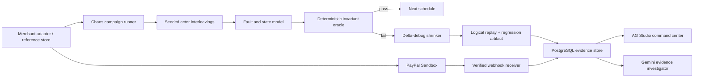

# AgentProof

**Chaos engineering for agentic commerce. Find the payment failure you didn't know to test.**

AgentProof explores combinations of payment retries, delayed or repeated webhooks, worker interleavings, network response loss, and merchant behavior. It checks each resulting state with deterministic financial invariants, shrinks a discovered counterexample, and saves the exact logical schedule as a replayable regression artifact.

AgentProof is a test platform for payment systems, not another shopping agent or payment firewall. The included Northstar Goods storefront is a reference system under test. It uses PayPal Sandbox for actual checkout scenarios; bounded schedule campaigns run against a local state model and clearly report zero PayPal requests.

## Why it matters

An agentic checkout is a distributed system. PayPal, a merchant API, a retrying agent, a webhook handler, and a fulfillment worker can all observe a different point in a payment. A happy-path test cannot prove that retries, delayed events, and concurrent workers preserve exactly-once financial behavior.

AgentProof turns those event orderings into explicit schedules. AI may help explore or explain evidence, PayPal Sandbox provides external transaction evidence, and deterministic code remains the authority on financial correctness.

## Product surfaces

- **Chaos Lab:** configure a seed, bounded execution count, concurrent actors, and an explicit local merchant fault. Inspect discovered violations, shrink history, exact replay, and regression JSON.
- **Failure shrinking and replay:** minimize the first schedule that preserves a violation; replay the logical schedule without reusing immutable PayPal IDs.
- **Chaos Command Center:** AG Studio report builder over campaign summaries, schedules, invariant failures, and trace evidence. The AG Studio AI assistant summarizes persisted evidence through a server-side Gemini adapter.
- **Reference merchant:** product catalog, business spending intent, cart, PayPal JS approval, server-side capture, and refund controls.
- **Payment integrations:** PayPal OAuth, Orders, capture, authorize/capture/void, stable idempotency keys, negative testing, webhook signature verification, event deduplication, and evidence tracing.
- **Buyer agent:** Gemini tool calling can search the catalog, manage a cart, and start a Sandbox order. The user must approve the PayPal order.

## Architecture



The local model runner does not impersonate PayPal. A campaign's `externalPaymentRequests: 0` field distinguishes local schedule evidence from PayPal Sandbox evidence.

## Technology

Bun workspaces, TypeScript, React, Hono, PostgreSQL, Drizzle, PayPal REST and JS SDK, Gemini, AG Grid, AG Studio, and Caddy for the Render web container.

## Local setup

Requirements: Bun 1.x and Docker Compose. Copy `.env.example` to `.env` only if you need a fresh configuration; keep existing credentials in your local `.env`.

```sh
bun install
docker compose up -d postgres
cd apps/api
bun run db:migrate
cd ../..
bun run dev
```

Open <http://localhost:5173>. The API listens on <http://localhost:8787>. `/health` reports service configuration and connectivity; `/ready` checks database availability.

## Focused verification

```sh
bun test tests packages apps/api/src
bun run typecheck
bun run build
bun run chaos -- --seed=42 --runs=25 --actors=3
bun run chaos -- --seed=17 --runs=25 --actors=3 --inject-duplicate-fulfillment --expect-failure
```

The CLI campaign is deterministic local model exploration. It never calls PayPal. Add those commands to a CI job; an unsafe campaign should pass only when `--expect-failure` finds the injected invariant violation.

## Environment

See `.env.example` for the complete variable list. The web app uses same-origin API routing outside Vite development. `AG_STUDIO_LICENSE_KEY` is optional for development and should be set for a licensed deployment. PayPal webhook verification requires `PAYPAL_WEBHOOK_ID` from the Sandbox app webhook configuration. PayPal, Gemini, and Render credentials stay on the server; only the AG Studio license key and PayPal client ID are returned to the browser.

## Chaos model boundaries

The current campaign engine explores bounded seeded interleavings of buyer, webhook-worker, and fulfillment-worker actions. Its execution cap is 1,000 schedules. Campaign evidence is model evidence, not a claim that every schedule was executed against a live merchant or PayPal. The API and storefront retain real PayPal Sandbox workflows for representative external validation.

The current adapter surface is the included reference merchant API. `docs/merchant-adapter.md` describes the extension contract and its current boundary; a generic third-party SDK/adapter is not yet implemented.

## Documentation

- [Architecture](docs/architecture.md)
- [Chaos engine and coverage](docs/chaos-engine.md)
- [Failure shrinking](docs/failure-shrinking.md)
- [Replay and regression artifacts](docs/replay.md)
- [Merchant adapter boundary](docs/merchant-adapter.md)
- [CI use](docs/ci.md)
- [PayPal integration](docs/paypal-integration.md)
- [Threat model](docs/threat-model.md)
- [Three-minute demo](docs/demo-script.md)
- [Manual component and end-to-end guide](docs/final-manual-e2e.md)
- [Hackathon submission draft](docs/hackathon-submission.md)

## Render

`render.yaml` defines the API, web proxy, and PostgreSQL services. Deploy it as a Blueprint, enter the PayPal Sandbox, Gemini, and optional AG Studio license values in Render's secret prompts, then configure a PayPal webhook against `https://<web-service>/api/webhooks/paypal`. Do not turn on live PayPal credentials for this demo deployment.

## Hackathon alignment

PayPal is the external payment authority: the reference merchant creates and captures Sandbox orders, stores stable request IDs, verifies signed webhooks, and limits refunds. AI is used for buyer tool-calling, scenario generation, and evidence-based investigation. The deterministic invariant engine—not an LLM—decides payment correctness. AG Studio lets operators build cross-filtered reports from actual recorded evidence.

## License

The AgentProof application code is released under the [MIT License](LICENSE).

Third-party services and packages retain their own terms. In particular, AG Studio is commercially licensed software: keep `AG_STUDIO_LICENSE_KEY` in environment configuration and follow AG Grid's terms for trial or production use. PayPal Sandbox and Gemini credentials are also subject to their respective provider terms and must never be committed.
